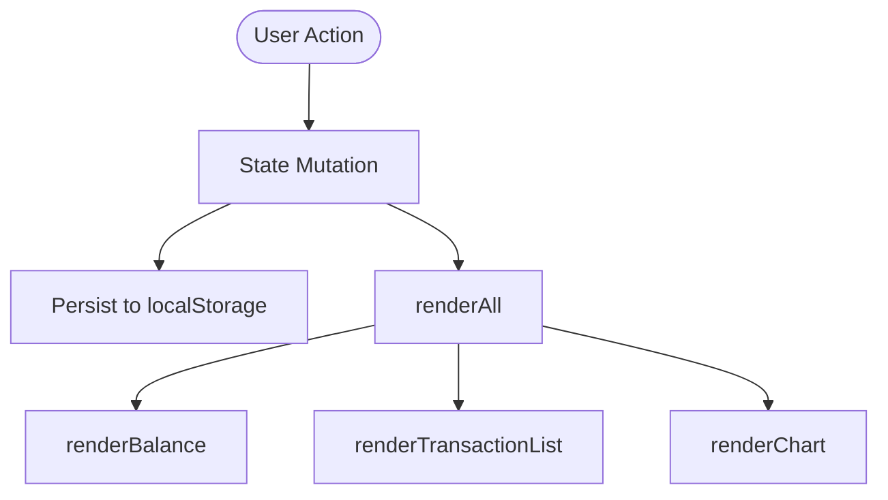

# Design Document

## Overview

The Expense & Budget Visualizer is a single-page, client-side web application built with plain HTML, CSS, and Vanilla JavaScript. It runs entirely in the browser — no server, no build step, no package manager. Users can record expenses by name, amount, and category; view a running total; browse a reverse-chronological transaction list; delete entries; and read a live-updating pie chart of category spending.

All state is persisted in `localStorage` as a JSON array. The only external dependency is [Chart.js v4](https://www.chartjs.org/docs/latest/) loaded from a CDN `<script>` tag.

---

## Architecture

The application follows a **unidirectional data-flow** pattern inside a single JS module:

```
User Action
    │
    ▼
State Mutation (in-memory array)
    │
    ├──► localStorage write
    │
    └──► Re-render all UI components
              ├── Balance Display
              ├── Transaction List
              └── Pie Chart
```

There are no frameworks and no virtual DOM. Every mutation ends with a full synchronous re-render of all three UI regions. Because the data set is small (personal expense tracking), a full re-render on every change is cheap and keeps the logic simple.



### Module Boundaries

| File | Responsibility |
|---|---|
| `index.html` | DOM skeleton, CDN script tag, links to `css/style.css` and `js/app.js` |
| `css/style.css` | All visual styling, layout, toast animations |
| `js/app.js` | Entire application logic — state, storage, validation, rendering |

This maps directly to the file-structure requirement (one HTML, one CSS, one JS).

---

## Components and Interfaces

### 1. Input Form

**DOM elements**
- `<input type="text" id="item-name" maxlength="100">` — item name
- `<input type="number" id="item-amount" step="0.01" min="0.01" max="999999999.99">` — amount
- `<select id="item-category">` — options: Food, Transport, Fun
- `<button type="submit">` — triggers validation and add
- `<div id="form-errors">` — inline validation error container

**JS interface**
```js
// Called on form `submit` event
function handleFormSubmit(event) { … }

// Returns a validated transaction object or throws with a user-readable message
function validateForm(name, amount, category) { … }

// Clears all fields and resets category selector to "Food"
function resetForm() { … }
```

### 2. Transaction List

**DOM elements**
- `<ul id="transaction-list">` — scrollable list container
- Each `<li>` contains: item name, formatted amount, category label, delete `<button>`

**JS interface**
```js
// Wipes and re-renders the entire list from the in-memory array
function renderTransactionList(transactions) { … }

// Called on delete button click — shows confirm dialog, then removes
function handleDelete(id) { … }
```

Display order: newest transaction first (index `length - 1` down to `0`).

Placeholder: when `transactions.length === 0`, renders a single `<li class="empty-state">` with the message "No expenses added yet."

### 3. Balance Display

**DOM elements**
- `<div id="balance-display">` — single element above the list
- Inner `<span id="balance-amount">` — holds the formatted currency string

**JS interface**
```js
// Sums all amounts and writes formatted currency into the DOM
function renderBalance(transactions) { … }
```

Currency format: `$0.00` for zero; `-$10.00` for negative (minus prefix before the symbol); standard `$1,234.56` for positive. Uses `Intl.NumberFormat` for locale-aware formatting.

### 4. Pie Chart

**DOM elements**
- `<canvas id="spending-chart">` — target for Chart.js
- `<div id="chart-empty-state">` — shown when no transactions exist
- `<div id="chart-error">` — shown when Chart.js CDN fails to load

**JS interface**
```js
// Module-level variable holding the active Chart instance (or null)
let chartInstance = null;

// Creates or updates the pie chart from the in-memory transaction array
function renderChart(transactions) { … }
```

**Update strategy**: On every `renderChart` call, if `chartInstance` exists, mutate `chartInstance.data.datasets[0].data`, `chartInstance.data.labels`, then call `chartInstance.update()`. This avoids destroying and re-creating the canvas context on each change, which prevents the "canvas already in use" error.

**CDN failure detection**: An `<script onerror>` handler on the Chart.js `<script>` tag sets a module-level flag `chartLibraryFailed = true`. `renderChart` checks this flag and shows the `#chart-error` div instead of attempting to draw.

**Chart configuration**
```js
{
  type: 'pie',
  data: {
    labels: ['Food', 'Transport', 'Fun'],   // only categories with > 0 total
    datasets: [{ data: [/* category totals */] }]
  },
  options: {
    responsive: true,
    plugins: {
      legend: { position: 'bottom' },
      tooltip: {
        callbacks: {
          label: (ctx) => `${ctx.label}: $${ctx.raw.toFixed(2)}`
        }
      }
    }
  }
}
```

### 5. Toast / Warning Notification

**DOM elements**
- `<div id="toast-container">` — fixed-position overlay, `aria-live="polite"`

**JS interface**
```js
// Renders a non-blocking toast message that auto-dismisses after 4 s
function showToast(message, type = 'warning') { … }
```

Used for: localStorage unavailable, localStorage quota exceeded, Chart.js CDN load failure.

---

## Data Models

### Transaction Object

```js
/**
 * @typedef {Object} Transaction
 * @property {string}  id        - UUID (crypto.randomUUID())
 * @property {string}  name      - Item name (1–100 chars)
 * @property {number}  amount    - Positive number, max 2 decimal places
 * @property {string}  category  - 'Food' | 'Transport' | 'Fun'
 * @property {number}  timestamp - Unix ms timestamp (Date.now())
 */
```

### In-Memory State

```js
// Single source of truth — all UI renders read from this array
let transactions = []; // Transaction[]
```

### localStorage Schema

```
Key:   "ebv_transactions"
Value: JSON.stringify(Transaction[])
```

Example stored value:
```json
[
  {
    "id": "550e8400-e29b-41d4-a716-446655440000",
    "name": "Lunch",
    "amount": 12.50,
    "category": "Food",
    "timestamp": 1700000000000
  }
]
```

### localStorage Access Layer

```js
const STORAGE_KEY = 'ebv_transactions';

// Returns Transaction[] (empty array on any error)
function loadFromStorage() { … }

// Returns true on success, false on failure (quota exceeded, unavailable)
function saveToStorage(transactions) { … }
```

Both functions wrap all `localStorage` calls in `try/catch`. `saveToStorage` catches `QuotaExceededError` and similar `DOMException` subtypes, calls `showToast(...)`, and returns `false` without mutating the in-memory array.

### Category Aggregation (for Chart)

```js
// Returns { Food: number, Transport: number, Fun: number }
function aggregateByCategory(transactions) {
  return transactions.reduce((acc, t) => {
    acc[t.category] = (acc[t.category] ?? 0) + t.amount;
    return acc;
  }, { Food: 0, Transport: 0, Fun: 0 });
}
```

Only categories with a total > 0 are passed to the chart's `labels` and `data` arrays.

---

## Correctness Properties

*A property is a characteristic or behavior that should hold true across all valid executions of a system — essentially, a formal statement about what the system should do. Properties serve as the bridge between human-readable specifications and machine-verifiable correctness guarantees.*

### Property 1: JSON round-trip preserves transaction data

*For any* array of valid transaction objects, serializing the array to a JSON string and then parsing that string SHALL produce an array with the same number of items, and each item's `id`, `name`, `amount`, `category`, and `timestamp` fields SHALL be strictly equal to those in the original array.

**Validates: Requirements 6.4**

### Property 2: Balance equals sum of amounts

*For any* array of transactions (including an empty array), the value rendered in the Balance Display SHALL equal the arithmetic sum of all `amount` fields in the array, to two decimal places.

**Validates: Requirements 4.2, 4.3, 4.4, 4.5**

### Property 3: Category aggregation totals equal overall balance

*For any* non-empty array of transactions, the sum of all per-category totals returned by `aggregateByCategory` SHALL equal the sum of all transaction amounts in the array.

**Validates: Requirements 5.1**

### Property 4: Valid-input form submission increases list length by one

*For any* current transaction list and any valid form submission (non-empty name, amount in [0.01, 999999999.99], valid category), calling the add-transaction handler SHALL result in the transaction list containing exactly one more item than before.

**Validates: Requirements 1.2**

### Property 5: Whitespace-only or invalid-amount submissions are rejected

*For any* form submission where the name is composed entirely of whitespace characters, or the amount is zero, negative, non-numeric, or greater than 999999999.99, the transaction list length SHALL remain unchanged.

**Validates: Requirements 1.3, 1.4**

### Property 6: Delete reduces list by exactly one and updates balance

*For any* non-empty transaction list and any valid transaction `id` in that list, deleting the transaction with that `id` SHALL result in a list of exactly `length - 1` items, and the balance SHALL equal the sum of the remaining items' amounts.

**Validates: Requirements 3.3, 3.4**

### Property 7: Corrupt storage records are skipped, valid records are preserved

*For any* localStorage value that is a JSON array in which some elements are invalid (missing required fields), `loadFromStorage` SHALL return only the valid elements and SHALL NOT throw or return `null`.

**Validates: Requirements 2.5**

---

## Error Handling

| Scenario | Detection | Response |
|---|---|---|
| Form field empty | `name.trim() === ''` or `amount === ''` | Inline error message in `#form-errors`; form not submitted |
| Amount out of range or non-numeric | `isNaN(amount)` or value outside [0.01, 999999999.99] | Inline error message; form not submitted |
| `localStorage` unavailable (private browsing, security policy) | `try/catch` around `localStorage.getItem` on init | Init with `[]`; show persistent inline notice |
| `localStorage` quota exceeded on write | `catch (DOMException)` in `saveToStorage` | Toast warning; in-memory array unchanged |
| Corrupt record in `localStorage` | Per-item validation in `loadFromStorage` | Skip bad records; load valid ones |
| Chart.js CDN fails to load | `<script onerror>` on CDN tag | Show `#chart-error` message; flag prevents further Chart.js calls |
| Delete confirmation declined | `window.confirm` returns `false` | No action taken |

**Validation error messages** are shown in `#form-errors` immediately below the form. They disappear the next time the user successfully submits or resets the form.

**Toast notifications** appear in `#toast-container` (top-right, fixed position), auto-dismiss after 4 seconds, and stack if multiple are queued. They use `aria-live="polite"` so screen readers announce them without interrupting.

---

## Testing Strategy

### Unit Tests

Because this is a Vanilla JS, no-build project, unit tests are written using a minimal in-browser test harness or a lightweight test runner that doesn't require Node (e.g., [Tape](https://github.com/tape-testing/tape) loaded via CDN, or plain assertions in a `test.html` file).

Focus areas:
- `validateForm(name, amount, category)` — covers empty fields, edge amounts (0, 0.01, 999999999.99, 1000000000), non-numeric strings
- `aggregateByCategory(transactions)` — single category, multiple categories, empty array
- `loadFromStorage()` — simulated corrupt data, empty storage, unavailable storage
- `saveToStorage(transactions)` — simulated quota error (mock `localStorage.setItem` to throw)
- Currency formatting — zero, negative values, values requiring comma separators

### Property-Based Tests

Property-based testing validates universal behaviors across many generated inputs. The recommended library for Vanilla JS (no build step, CDN-loadable) is [fast-check](https://fast-check.dev/), which can be loaded via CDN:

```html
<script src="https://cdn.jsdelivr.net/npm/fast-check/lib/bundle/fast-check.js"></script>
```

Each property test must run a **minimum of 100 iterations**.

Tag format for each test:
> `// Feature: expense-budget-visualizer, Property N: <property_text>`

| Property | Test Approach | Generator |
|---|---|---|
| P1: JSON round-trip | Generate `Transaction[]`, stringify, parse, deep-equal | `fc.array(transactionArbitrary)` |
| P2: Balance = sum of amounts | Generate `Transaction[]`, compute expected sum, compare rendered value | `fc.array(transactionArbitrary)` |
| P3: Category totals = overall total | Generate `Transaction[]`, verify `sum(aggregateByCategory)` === `sum(amounts)` | `fc.array(transactionArbitrary)` |
| P4: Valid add grows list by 1 | Generate initial list + valid input tuple, verify length increments | `fc.tuple(fc.array(...), transactionArbitrary)` |
| P5: Invalid input rejected | Generate whitespace names and out-of-range amounts, verify list unchanged | `fc.string().filter(isAllWhitespace)`, `fc.float()` |
| P6: Delete reduces list by 1 and corrects balance | Pick a random list (≥ 1 item), pick random index, delete, verify | `fc.array(transactionArbitrary, { minLength: 1 })` |
| P7: Corrupt storage skipped | Generate mixed arrays of valid + invalid records, parse, verify only valid returned | `fc.array(fc.oneof(validRecord, invalidRecord))` |

**`transactionArbitrary`** is a composite fast-check arbitrary:
```js
const transactionArbitrary = fc.record({
  id:        fc.uuid(),
  name:      fc.string({ minLength: 1, maxLength: 100 }).filter(s => s.trim().length > 0),
  amount:    fc.float({ min: 0.01, max: 999999999.99, noNaN: true }),
  category:  fc.constantFrom('Food', 'Transport', 'Fun'),
  timestamp: fc.integer({ min: 0 })
});
```

### Integration / Manual Tests

These are verified by loading `index.html` in each target browser:

1. **Page load with existing data** — transactions render in reverse-chronological order
2. **Page load with no data** — empty-state placeholder is shown; balance shows $0.00
3. **Add transaction** — list, balance, and chart all update without reload
4. **Delete with confirmation accepted** — item removed from list, balance and chart update
5. **Delete with confirmation declined** — no change
6. **CDN blocked** — chart error message shown; rest of app functional
7. **Private browsing (Safari)** — localStorage unavailable notice shown; app usable
8. **Scroll behavior** — long transaction list scrolls independently of the chart/balance area
9. **Cross-browser** — Chrome, Firefox, Edge, Safari (latest stable)
